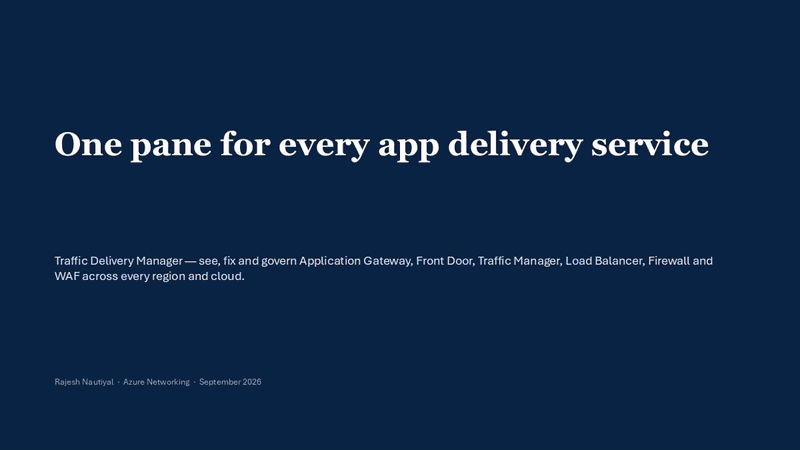
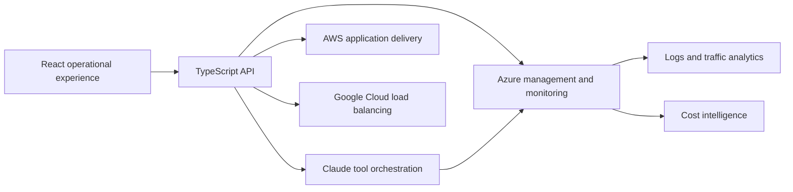

# Traffic Delivery Manager

An AI-assisted multi-cloud control plane for application delivery across Azure, AWS, and Google Cloud. Traffic Delivery Manager brings health, security, resiliency, observability, and cost signals into one executive and operational view.

> The hosted portfolio demo is read-only and available until April 9, 2027. It uses live cloud telemetry, so views may vary with resource state and provider availability. Configuration changes, write operations, and AI actions are disabled for public sessions.

## Product Walkthrough

[Watch the full-quality walkthrough](docs/traffic-delivery-manager-demo.mp4) | [Download the overview deck](docs/Traffic-Delivery-Manager-Overview.pptx) | [Launch the read-only demo](https://appgw-manager.ambitiousriver-d987d50a.eastus.azurecontainerapps.io/demo/f59t3v9wkkk7ya)

## What I Built

I designed and built Traffic Delivery Manager as a unified operational experience for application delivery teams managing services across multiple cloud providers. The platform connects live cloud telemetry with AI-assisted diagnostics while maintaining strict identity and read-only controls for its public portfolio demo.

- **Command Center** presents fleet health, security posture, resiliency, and delivery cost across subscriptions, regions, and clouds.
- **Traffic Delivery Genie** uses Claude tool calling to inspect infrastructure and produce gateway Well-Architected reviews.
- **Ask the Logs** translates natural-language questions into schema-aware KQL for Azure Monitor and Log Analytics.
- **Traffic Analytics** visualizes requests, clients, backends, status codes, and timelines from gateway diagnostics.
- **Cost Intelligence** combines Azure Cost Management data, service breakdowns, forecasts, and optimization context.
- **Resiliency** brings Traffic Manager, Front Door, and health-based Private DNS failover into one workflow.
- **Network Security** surfaces WAF, Firewall, certificate, listener, and exposure findings.
- **Multi-cloud Inventory** includes AWS Application Load Balancers and Google Cloud load balancers alongside Azure services.

## Architecture

| Area | Technology |
| --- | --- |
| Experience | React 18, TypeScript, Fluent UI, Vite |
| Services | Node.js, Express, Azure/AWS/GCP SDKs |
| AI | Anthropic Claude with server-side tool orchestration |
| Identity | Microsoft Entra ID and signed read-only demo sessions |
| Cloud | Azure Container Apps, Azure Monitor, Log Analytics, Cost Management |

## Engineering Highlights

- Built a single operational model over Azure, AWS, and Google Cloud application delivery services.
- Integrated live health, diagnostics, security, traffic, resiliency, and cost data instead of static dashboard samples.
- Implemented Microsoft Entra JWT verification with issuer, audience, algorithm, and signing-key validation.
- Created expiring signed demo sessions with server-enforced read-only access.
- Added AI-assisted investigation workflows with controlled server-side tools and cloud context.
- Packaged the full experience for Azure Container Apps with production health and security controls.

## Portfolio Notice

This repository is a product showcase for resume and portfolio use. The application is under active development, and its source code and installation materials are not publicly distributed at this stage.

Built by **Rajesh Nautiyal**.